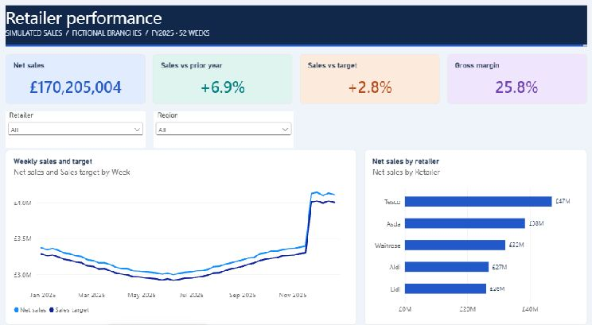

# UK FMCG Store Network Performance

This portfolio scenario compares FMCG sell-through at 75 fictional branches under the Tesco, Asda, Lidl, Waitrose and Aldi banners. All sales, store profiles, targets, costs and promotions are simulated. The results should be interpreted only within the scenario.

## Reports and insights

| Report | What it answers |
| --- | --- |
| [Executive trading report](reports/executive-trading-report.md) | How did the network perform, which retailer banners drove growth, and where did the aggregate results hide shortfalls? |
| [Store and category performance report](reports/store-and-category-report.md) | Which branches warrant review, how did store formats compare with plan, and which categories generated the most gross profit? |



## Portfolio case study

The [case study](docs/case-study.md) follows a weekly trading review from the full network to two London branches that missed target. Both dashboard versions reproduce the same network and London totals.

| Dashboard view | Power BI | Tableau |
| --- | --- | --- |
| Retailer performance | [Network overview](docs/screenshots/powerbi-overview.png) | [Network overview](docs/screenshots/tableau-overview.png) |
| Store network | [London drill-down](docs/screenshots/powerbi-london.png) | [London drill-down](docs/screenshots/tableau-london.png) |

## About the reports

The Power BI and Tableau project files are kept private and are not in this repository. The interactive dashboards will be published separately for viewing; the screenshots and build notes here document them.

- [Power BI build notes](powerbi/README.md), with the [DAX measures](powerbi/Model.dax) and [Power Query](powerbi/WeeklySales.pq). The model embeds the simulated data, so it loads without an external CSV. Each page has retailer, region, store format or category slicers.
- [Tableau build notes](tableau/README.md). The workbook packages a Hyper extract. Selecting the retailer, region or category bars on each dashboard filters its other views; Esc clears the selection.

## Measures

The model contains 27,300 rows at **store × week × category** grain across five regions, three store formats and seven categories. The 52-week reporting period starts on 30 December 2024 and ends on 28 December 2025. Each current-period row includes a simulated comparison for the equivalent prior-year week, category and store, and an independently tracked sales target set at 4% above that prior-year baseline.

| Measure | Definition |
| --- | --- |
| Net sales | Units sold at the applicable list or promotional price, in GBP. The simulation has no separate refund or tax transactions. |
| Sales vs prior year | Net sales less matched prior-year sales, divided by matched prior-year sales. |
| Sales vs target | Net sales less target, divided by target. |
| Gross margin | Simulated gross profit divided by net sales. |
| Promo sales share | Promotional revenue divided by net sales. |
| Net sales per store | Net sales divided by distinct stores in the selected view. |

## Rebuild

Run from the repository root. Python is required, and the Tableau builder requires `tableauhyperapi`.

```sh
python scripts/fmcg_data.py
python scripts/build_powerbi.py
python scripts/build_tableau.py
```

The generator uses a fixed seed and stores amounts in integer pence. The generated CSV is available under the Git-ignored `data/fmcg/` directory. Both builders use the same simulation function.

In desktop checks, both reports showed £170,205,004 in simulated network sales and £32,114,473 with Waitrose selected, rounded to the nearest pound. Tableau's London action narrowed the network from 75 to 15 stores, and its Chilled and dairy selection updated the category KPIs.
