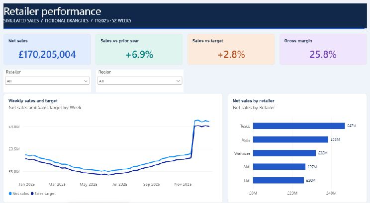
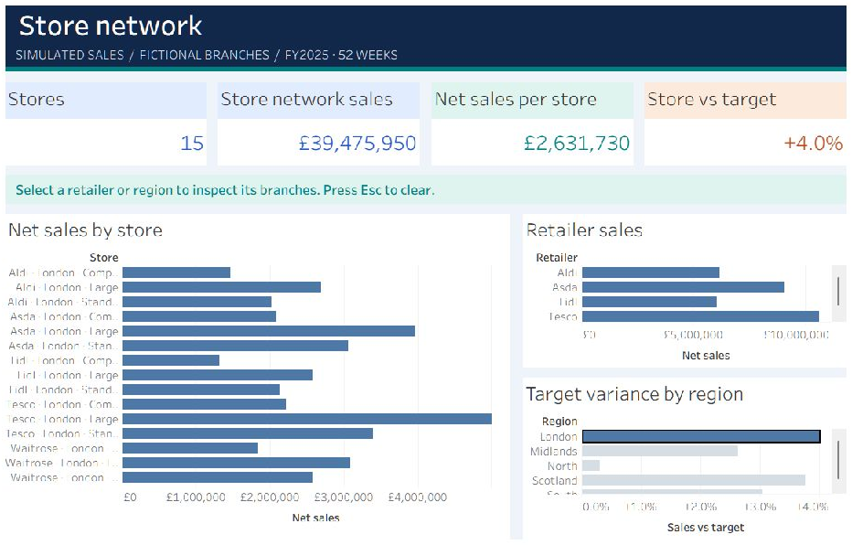

# UK FMCG Store Network Performance

A retail operations team needs to know whether sales are on target and which branches warrant a closer look. This portfolio scenario uses **simulated data** for 75 fictional branches under the Tesco, Asda, Lidl, Waitrose and Aldi banners. It covers 52 weeks ending 28 December 2025.

## Start with the network

The network recorded **£170.2m** in simulated net sales, **6.9% above the matched prior year** and **2.8% above target**, with a **25.8% gross margin**. The weekly view shows when sales changed, and the retailer comparison shows where those sales were concentrated.

## Drill into London

On the Store network page, select **London** in the Power BI Region slicer or click the **London** bar in Tableau’s regional variance chart. The view narrows from 75 branches to 15. London recorded **£39.5m** in simulated net sales, **8.2% above the prior year** and **4.0% above target**.

London’s combined result includes two branches that fell short. The simulated Tesco London Large branch had the highest sales in London and still missed its own target by **£103,211**. The simulated Waitrose London Large branch had the biggest cash shortfall at **£175,555**. Thirteen branches exceeded target, leaving London **£1.52m ahead overall**.

| London branch | Net sales | Sales target | Cash variance | Variance |
| --- | ---: | ---: | ---: | ---: |
| Waitrose · London · Large | £3,095,567 | £3,271,122 | −£175,555 | −5.4% |
| Tesco · London · Large | £5,002,755 | £5,105,966 | −£103,211 | −2.0% |

Sales rankings surface the biggest branches. Comparing each branch to its own plan surfaces the exceptions an operations team would investigate. The branch-level target gaps above were calculated from the weekly fact data. The Store network dashboard displays target variance by region.

## How the figures were built

The two reports use 27,300 simulated **store × week × category** records. Each row includes current sales, matched prior-year sales, a sales target, units, gross profit and promotional revenue. Targets are set 4% above the matched prior-year baseline. Variances use summed sales and summed targets within the selected scope. Gross margin uses summed gross profit divided by summed sales. The fixed-seed [generator](../scripts/fmcg_data.py) makes the simulation reproducible.

## Review the evidence

| View | Power BI | Tableau |
| --- | --- | --- |
| Network overview | [Screenshot](screenshots/powerbi-overview.png) | [Screenshot](screenshots/tableau-overview.png) |
| London drill-down | [Screenshot](screenshots/powerbi-london.png) | [Screenshot](screenshots/tableau-london.png) |
| Build notes | [Power BI build notes](../powerbi/README.md) | [Tableau build notes](../tableau/README.md) |

See the [project README](../README.md) for the remaining measure definitions and rebuild instructions.
